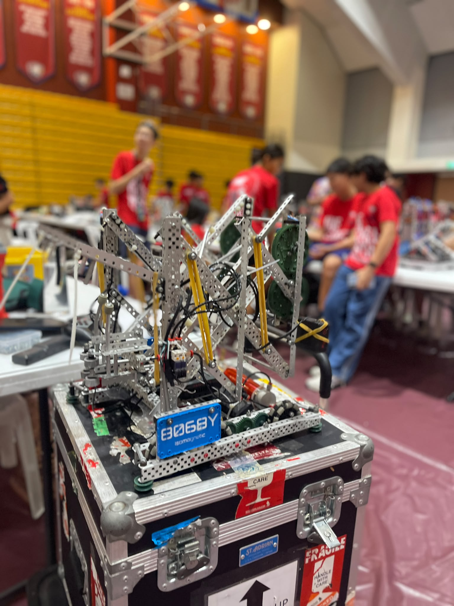
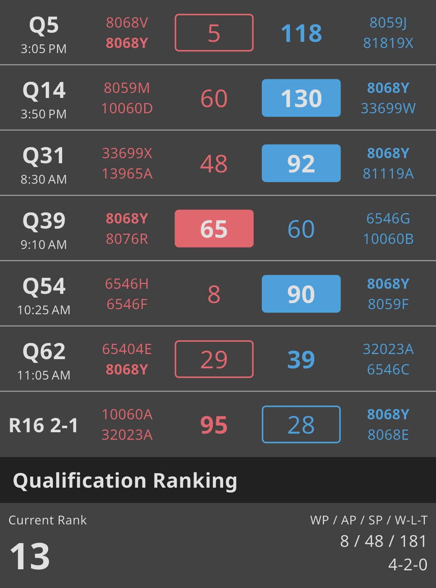

--- 
layout: post
title: 2026 SAS Spooky Robo Rumble - VEX Override
---

Over the weekend, three SST teams competed in the VEX Override Spooky Robo Rumble, hosted by Singapore American School. The event saw a total of 48 schools take part. Robo Rumble is also the first official VEX tournament of the local season, with nine open spots up for grabs to qualify for the Singapore Nationals in January 2027. 

The event is also the only local tournament to span multiple days, taking up both days of the weekend. My team, 8068Y Isomagnetic, built a 6-Bar / 4-Bar hybrid lift, which you can read more about [here](https://gnnadia123.github.io/projects/vex-rumble-26.html). 

On day one, we arrived in SAS just past noon, and kicked off the day with practice matches. Our first match saw us allianced with 13965P, UWC Dover, against 6546G and 65404E, SAS's High School and Middle School teams respectively. However, due to technical issues, there were no officially recorded match scores. 

We managed to play one qualification match before the day ended, which had us alliance with sister team 8068V Isochromatic, against ACSI's 8069J and Innovac's 81819X. 8068V's bot had technical issues, and left us in a 1v2 situation. We suffered a humiliating loss of 118-5. However, we pulled it together for our next match with AK robotics, 33699W, against ACSI's 8059M and MS AK Robotics 10060D, and won 130-60. This left day 1 with a mediocre result of 1-1-0 on our win-loss-tie ratio. 

Nevertheless, we walked into Day 2 with a fresh mind, ready to play for the day. We won our next three games in a row, before ultimately losing our final qualification match narrowly to 6546C and 32023A 29-39. A notable match was Q39, which saw us go against 10060B, AK Robotics Team B, which was undefeated at the time and going 4-0-0. Meanwhile, 8076R, HCI Team R, had their W-L-T ratio at 1-2-0. The hard fought battle surprised us with a narrow by a mere 5 points, and we were the only alliance to beat 10060B in qualifications, ending their perfect winstreak and reducing their overall W-L-T to 5-1-0. We were also one of only four teams to beat them throughout the entire tournament. 

We ended our qualification run in 13th, with a W-L-T ratio of 4-2-0, and a Strength-of-Schedule point value of 181 SP. Our sister teams 8068V Isochromatic and 8068E Isodynamic qualified 30th and 37th respectively. When it came to our turn of alliance selection, we picked sister team 8068E Isodynamic after seeing their strong performance at other competitions, to form the 9th seeded alliance. 

In the rounds of 16, we faced 8th seeded alliance 10060A AK Robotics and 32023A UWC East West Dragon Robotics. After a hard fought match, we were ultimately unable to secure the toggles in the endgame, resulting in a loss of 95-28, which ended our elimination run early. 

However, being knocked out doesn't mean we didn't take anything home, although we did not receive any physical awards. I learnt that we should always keep our heads up and learn from our mistakes, just like how a humiliating loss on day 1 led to the building of a 4 match winstreak. Another virtue we learnt is to persevere and push through no matter how difficult times get, giving it our all and arguing for every point even if hopes of changing match results are slim. In those past two days, I felt like I did do my level best, gave it my all, and the result was the highest I'd ever qualified in such a large tournament. 

With that said, there's still a lot to be done ahead of the Singapore VM Edu VEX Competition (or SingVEX for short) hosted at Canberra Secondary School. Our bot's build quality could definitely be improved, our Skills and Autonomous Skills need work, and driver practice is crucial to our performance. 

We will return at SingVEX! 