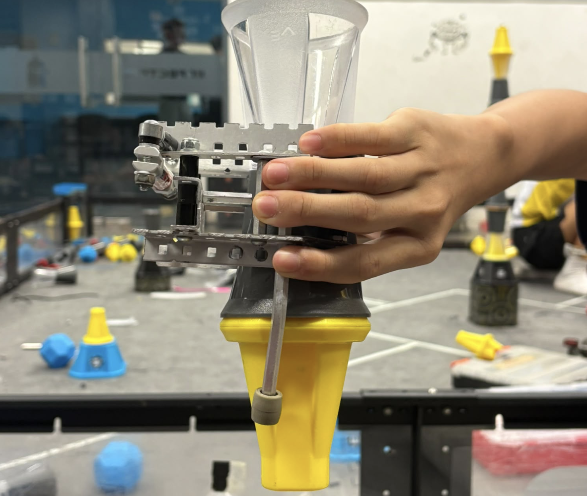

**The third iteration of our VEX Override robot is here!**

This robot is built after major international Signature Events such as University of North Dakota at Mall Of America, Speedway, and Great Planes. After analysing countless matches, we settled on a design which aimed to patch the gaps left by our IDE robot for an overall more well-performing robot. 

# 1. The Drivetrain

The drivetrain is the most crucial part of any robot. In IDE, drivetrain reliability proved to be crucial after our 5.5W motors kept coming loose and drive started to camber inwards due to insufficient bracing. As such, our V3 drivetrain is much sturdier, with more bracing, drivetrain boxing[1], and the use of Loctite to secure the screws. More importantly, the biggest change is that we included a high strength shaft brace, which boosted drivetrain sturdiness significantly as it prevents it from bending. Since high-strength shafts are much stronger than normal aluminium channels or standoffs, it kept our drivetrain much straighter and made it much more reliable. 

We reduced our drivetrain power usage from 55W at IDE to 44W. The reduced power allows for much easier maintenance and redundancy, as there is no need to have a separate section of gearing the 5.5W motors on each side. 

*[1] Drivetrain boxing - a term used when spacers are put at the end of every C-channel to ensure the short ends of the 'C' dont collapse inward on itself. Acts as a support structure to keep the spacing correct.*

# 2. The Lift

The lift on our bot is the most interesting. When we were doing research, only four main mechanisms which were viable appeared. The Double-Reverse 4 Bar (DR4B), Double-Reverse 6 Bar (DR6B), Chainbar, and Cascade/Continuous lifts. After IDE, we realised that we spent way too much time trying to maintain our cascade bot in between matches, especially with the string, friction and tensioning. As a team, it was a collective decision to return to bar lifts, seeing as how they were much easier to maintain and would be more suitable if we had back-to-back matches. 

However, a particular team stood out to us. 471B Moonshot. Their lift was a 6-bar, and a 4-bar, geared together, which stunned many of us at first. How would something like that even work?

Upon further analysis of the pit interview video, we finally understood the mechanism. By scaling the length of the 4bar in proportion to the 6-bar, they were able to create a linear hybrid DR46B, achieving insane cycle times[2] of under three seconds! The design also allowed weight to be concentrated at the bottom, lowering the robot's center of gravity, while putting less load on the upper half, which allowed for lower torque being needed to lift at higher heights. 

*[2] Cycle time - a term used in this season describing the time taken to matchload a pin-cup stack, score it on a nearby goal, and come back, completing one cycle.*

# 3. The Claw

This time, our claw operated differently compared to the last two iterattions. V1 used a motorised claw with two 5.5W motors on each side, while V2 made use of a motorised clamp. In V3, we decided to switch to using pneumatics, making use of a 25mm piston that actuates almost immediately with a single press of a button. 

Why pneumatics? Although having an air tank adds more weight, pistons actuate almost instantly, allowing for quicker cycle times and scoring speeds. Having motors on the claw/clamp also adds additional weight to the highest point of the bot, whereas a pistonised mechanism is much lighter compared to using motors. 

Inspired by 20850Z Full Throttle, our claw also features bent standoffs mounted atop the claw. This is to help grip the pin in place and prevent it from moving, and it works so effectively that we can even mount it upside down. There are also cut rubber flexwheels at the front of the claw which allow for more grip. 

# 4. The toggle

For our toggle, nothing much changed from the previous iteration as we felt that the previous toggle was already good enough. We mounted the toggle on the sides of the structural C-channels, tensioned down by rubber bands. 

However, there was one minor change, and those are "whiskers" on the far end of the toggle, which are long zipties secured to the robot to extend our reach. Although the secure virtually nothing, game rule '<SC4>' mentions "A toggle is considered set to a color when not in contact with a Robot from either Alliance." This means that as long as the sightest piece of our "whiskers" are touching a toggle, every yellow pin in the quadrant is rendered useless regardless of how many are scored or what the colour of the toggle is currently set to. In the endgame, this allows us to defend much more effectively without trying to get the whole robot to fight for the toggle. 

# Verdict

Overall, after these changes, we managed to qualify 4-2-0 and rank 13th out of 48 teams, which places us in the top 27% of teams. Meanwhile, we ranked 9th out of 17 teams in IDE for a percentile of 52%. The Robo Rumble bot's improvements are definitely clear and helped us achieve higher rankings. 

However, there is still a lot to be done ahead of the VM Singapore VEX Championship, more commonly known as SingVEX. After analysing multiple teams, we decided to make do with a quick rebuild ahead of SingVEX, overhauling our entire robot. Stay tuned!